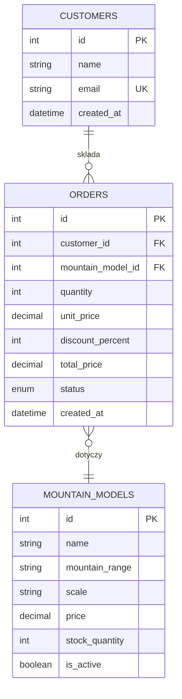

# Mountain Models Store

Backendowa aplikacja REST API dla sklepu z makietami górskimi. Umożliwia zarządzanie klientami i katalogiem makiet, składanie zamówień, kontrolę stanów magazynowych oraz obsługę statusów zamówień.

## Użyte technologie

- **Python 3.11+**
- **FastAPI** — framework REST API z automatyczną dokumentacją Swagger UI
- **SQLAlchemy 2.0** — ORM w trybie synchronicznym
- **Pydantic v2** — schematy DTO i walidacja danych wejściowych
- **PostgreSQL 16** — baza danych obsługiwana przez sterownik `psycopg2-binary`
- **Docker Compose** — uruchomienie bazy danych z trwałym wolumenem

## Architektura projektu

- `app/routers/` — przyjmuje żądania HTTP, wywołuje serwisy i zwraca odpowiedzi.
- `app/schemas/` — definiuje DTO i sprawdza m.in. poprawność e-maila, cenę i ilość.
- `app/services/` — stosuje reguły biznesowe i zarządza transakcjami.
- `app/repositories/` — odczytuje i zapisuje dane w bazie.
- `app/models/` — definiuje tabele SQLAlchemy i relacje.
- `app/exceptions.py` — zawiera wyjątki obsługiwane w `app/main.py`.

## Główne funkcjonalności i reguły biznesowe

1. **Dostępność i rezerwacja.** Przy składaniu zamówienia backend sprawdza, czy klient i makieta istnieją, czy makieta jest aktywna i czy wystarczy sztuk. Zapis zamówienia i zmniejszenie zapasu odbywają się w jednej transakcji.
2. **Cena i rabat ilościowy.** Użytkownik podaje ID klienta, ID makiety i liczbę sztuk. Backend pobiera cenę z bazy i nalicza **10% rabatu od 3 sztuk**.
3. **Zmiana statusu i anulowanie.** Zamówienie przechodzi z `NEW` przez `PAID` do `SHIPPED`. Osobny endpoint anuluje zamówienie w stanie `NEW` lub `PAID` i zwraca sztuki do magazynu. Próba anulowania wysłanego lub już anulowanego zamówienia zwraca `409`.

Adres e-mail klienta musi być unikalny. Próba usunięcia klienta lub makiety powiązanych z zamówieniem zwraca `409`.

## Diagram modelu danych (ERD)



## Instrukcja uruchomienia

Potrzebujesz Pythona 3.11+ oraz Dockera z Docker Compose. Wykonuj polecenia w katalogu projektu.

1. Uruchom bazę PostgreSQL i sprawdź jej status:

   ```bash
   docker compose up -d
   ```

   ```bash
   docker compose ps
   ```

   Poczekaj, aż kontener będzie miał stan `healthy`.

2. Skopiuj konfigurację i przygotuj środowisko wirtualne w PowerShellu:

   ```powershell
   Copy-Item .env.example .env
   ```

   ```powershell
   python -m venv .venv
   ```

   ```powershell
   .\.venv\Scripts\Activate.ps1
   ```

   Na Linuksie lub macOS wykonaj te same kroki w terminalu:

   ```bash
   cp .env.example .env
   ```

   ```bash
   python3 -m venv .venv
   ```

   ```bash
   source .venv/bin/activate
   ```

3. Zainstaluj zależności i uruchom API:

   ```bash
   python -m pip install -r requirements.txt
   ```

   ```bash
   python -m uvicorn app.main:app --reload
   ```

   Tabele utworzą się przy starcie. Żądania możesz wysyłać w [Swagger UI](http://127.0.0.1:8000/docs).

4. Opcjonalnie dodaj dane demonstracyjne. W drugim terminalu aktywuj środowisko i uruchom skrypt:

   ```bash
   python seed.py
   ```

   Skrypt dodaje dwóch klientów i trzy makiety. Karkonosze są nieaktywne i pozwalają sprawdzić błąd `409`.

### Zatrzymanie aplikacji i czyszczenie bazy danych

1. Zatrzymaj serwer FastAPI w terminalu skrótem `Ctrl + C`.

2. Zatrzymaj kontener bazy danych (z zachowaniem danych):

   ```bash
   docker compose down
   ```

3. Zatrzymaj kontener i **wyczyść bazę danych do zera** (usunięcie wolumenu z danymi):

   ```bash
   docker compose down -v
   ```

   Aby ponownie uruchomić czyste środowisko po resecie bazy, wykonaj kolejno (ostatnią komendę w drugim terminalu):

   ```bash
   docker compose up -d
   ```

   ```bash
   python -m uvicorn app.main:app --reload
   ```

   ```bash
   python seed.py
   ```

## Dokumentacja REST API

| Metoda | Endpoint | Kod sukcesu | Opis |
| --- | --- | --- | --- |
| GET | `/customers` | 200 | Pobiera listę klientów. |
| GET | `/customers/{id}` | 200 | Pobiera dane klienta. |
| POST | `/customers` | 201 | Dodaje klienta. |
| PUT | `/customers/{id}` | 200 | Aktualizuje dane klienta. |
| DELETE | `/customers/{id}` | 204 | Usuwa klienta bez zamówień. |
| GET | `/models` | 200 | Pobiera listę makiet. |
| GET | `/models/{id}` | 200 | Pobiera dane makiety i jej stan magazynowy. |
| POST | `/models` | 201 | Dodaje makietę. |
| PUT | `/models/{id}` | 200 | Aktualizuje dane makiety. |
| DELETE | `/models/{id}` | 204 | Usuwa makietę bez zamówień. |
| GET | `/orders` | 200 | Pobiera listę zamówień. |
| GET | `/orders/{id}` | 200 | Pobiera szczegóły zamówienia. |
| POST | `/orders` | 201 | Składa zamówienie, rezerwuje sztuki i wylicza cenę. |
| PATCH | `/orders/{id}/status` | 200 | Zmienia status zamówienia. |
| POST | `/orders/{id}/cancel` | 200 | Anuluje zamówienie i zwraca sztuki do magazynu. |

### Kody błędów

API zwraca błędy w formacie `{"error": "...", "detail": "..."}`.

- `400 Bad Request` — nie udało się odczytać żądania.
- `404 Not Found` — brak zasobu o podanym ID.
- `409 Conflict` — np. za mało sztuk, nieaktywna makieta, niedozwolona zmiana statusu lub powtórzony e-mail.
- `422 Unprocessable Entity` — niepoprawne dane, np. błędny e-mail lub ilość równa 0.
- `500 Internal Server Error` — nieoczekiwany błąd serwera.

### Scenariusz demonstracyjny w Swagger UI

Otwórz interaktywną dokumentację w przeglądarce: **[http://127.0.0.1:8000/docs](http://127.0.0.1:8000/docs)**

Poniższa ścieżka prezentuje pełne działanie aplikacji — od podstawowego CRUD-u i walidacji, przez reguły biznesowe, po integralność bazy danych. Przykłady zakładają świeżą bazę po uruchomieniu `seed.py`.

#### 1. Przegląd danych startowych — `GET /customers` i `GET /models`

Wywołaj oba endpointy bez parametrów. Zwróć uwagę na aktualny `stock_quantity` makiety o `id: 1` oraz flagę `is_active: false` dla makiety Karkonosze (`id: 3`).

#### 2. Dodanie klienta, duplikat e-maila i walidacja — `POST /customers`

1. Utwórz nowego klienta (`201 Created`):

```json
{
  "name": "Jan Kowalski",
  "email": "jan.kowalski@example.com"
}
```

2. Wyślij to samo żądanie drugi raz — API zwróci `409 Conflict` (unikalny e-mail).
3. Wyślij niepoprawny format e-maila (np. `"email": "bledny-email"`) — Pydantic odrzuci żądanie z kodem `422 Unprocessable Entity`.

#### 3. Dodanie i edycja makiety — `POST /models` i `PUT /models/{id}`

1. Dodaj nową makietę (`201 Created`) i zapamiętaj jej `id` (przyda się w kroku 10):

```json
{
  "name": "Bieszczady Wysokie",
  "mountain_range": "Bieszczady",
  "scale": "1:50000",
  "price": 249.99,
  "stock_quantity": 5,
  "is_active": true
}
```

2. Zaktualizuj jej cenę lub stan magazynowy przez `PUT /models/{id}` (`200 OK`).

#### 4. Zamówienie bez rabatu (1–2 sztuki) — `POST /orders`

```json
{
  "customer_id": 1,
  "mountain_model_id": 1,
  "quantity": 1
}
```

Oczekiwany wynik: `201 Created`, `discount_percent: 0`, `status: "NEW"`. Zapisz `id` (dalej: **Zamówienie A**). W `GET /models/1` zapas zmalał o 1 sztukę.

#### 5. Zamówienie z rabatem ilościowym (min. 3 sztuki) — `POST /orders`

```json
{
  "customer_id": 1,
  "mountain_model_id": 1,
  "quantity": 3
}
```

Oczekiwany wynik: `201 Created`, `discount_percent: 10`, automatycznie obniżona kwota `total_price`. Zapisz `id` (dalej: **Zamówienie B**). W `GET /models/1` zapas zmalał o kolejne 3 sztuki.

#### 6. Blokady biznesowe i błędy — `POST /orders`

1. **Brak wystarczającej liczby sztuk** (`quantity: 999`) — zwraca `409 Conflict`.
2. **Nieaktywna makieta** (`mountain_model_id: 3`, `quantity: 1`) — zwraca `409 Conflict`.
3. **Nieistniejący klient** (`customer_id: 999`, `mountain_model_id: 1`, `quantity: 1`) — zwraca `404 Not Found`.

#### 7. Poprawny i błędny przepływ statusów — `PATCH /orders/{id}/status`

Użyj ID **Zamówienia A**:

1. Spróbuj przeskoczyć od razu z `NEW` na `SHIPPED`:

```json
{
  "status": "SHIPPED"
}
```

Oczekiwany wynik: `409 Conflict` (niedozwolone przejście).

2. Zmień status poprawnie na `PAID` (`200 OK`), a następnie na `SHIPPED` (`200 OK`).

#### 8. Próba anulowania wysłanego zamówienia — `POST /orders/{id}/cancel`

Wywołaj endpoint dla **Zamówienia A** (ma już status `SHIPPED`). Oczekiwany wynik: `409 Conflict` — wysłanego zamówienia nie można anulować.

#### 9. Anulowanie zamówienia i zwrot na magazyn — `POST /orders/{id}/cancel`

Wywołaj endpoint dla **Zamówienia B** (status `NEW`, 3 sztuki).
- Oczekiwany wynik: `200 OK` oraz `status: "CANCELLED"`.
- Wywołaj `GET /models/1` — `stock_quantity` wzrósł z powrotem o 3 sztuki.
- Ponowne wywołanie `POST /orders/{id}/cancel` na tym samym zamówieniu zwróci `409 Conflict`.

#### 10. Ochrona integralności przy usuwaniu — `DELETE`

1. `DELETE /customers/1` — zwraca `409 Conflict` (klient ma przypisane zamówienia).
2. `DELETE /models/{id}` (dla makiety *Bieszczady Wysokie* z kroku 3, która nie ma zamówień) — zwraca `204 No Content`.